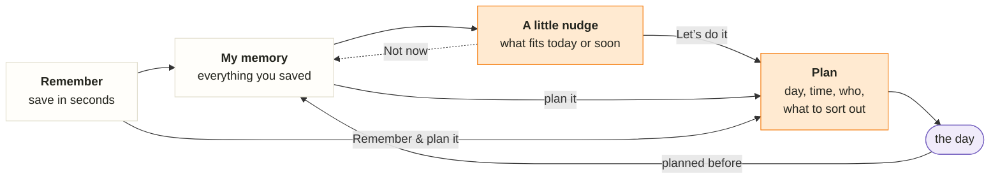

# Oh, right!

**Oh, right!** *your little memory*: an external memory for the things you want to experience, on your own and with your partner or friends, so that when you don’t know what to do, it does. Personal proof of concept; the goal is a phone app.

**See the design:** https://bazom.github.io/IdeaMemory/design/oh-app.html (clickable, made-up data).

## How it works



- **Remember:** save in seconds, just a title, or a link that fills in the rest.
- **My memory:** everything you saved, findable without remembering the words.
- **A little nudge:** brings the right memory back for today or soon; you decide *Let’s do it* or *Not now*.
- **Plan:** the concrete details for the day.
- **After the day:** back into the memory with a “planned before” line, to be suggested again, planned again or let go.
- **Together:** share a space with your partner or a group (up to 8). Everyone says *I’d love to* or *Not for me*; when you both say yes it’s a match, and you plan it together: find a day, who’s in, who sorts out what. (Designed; planned in roadmap phase 2.)

Why the app works this way, and what comes next: [roadmap](docs/roadmap.md). Where it could go one day: [vision](docs/vision.md).

## Status

**Now:** sign up with a username and password, then save ideas (just a title is enough; optional description, category, tags, notes, location and the exact original text), browse, edit and delete them. Each account sees only its own ideas. **Next:** see the [roadmap](docs/roadmap.md).

Parts: a Flutter Web app (`apps/mobile/`), a FastAPI service (`services/api/`), Supabase (auth + database) running locally in Docker (`supabase/`), a `Makefile` and GitHub Actions CI. Setup details, configuration and the API are in [development](docs/development.md); owner decisions in [decisions](docs/decisions.md); how we work in [engineering standards](docs/engineering-standards.md).

## Run it

Prerequisites: Flutter 3.47.6, Python 3.13, a running Docker engine.

```sh
make setup            # Python venv, Flutter packages, pinned Supabase CLI
make supabase-start   # local Supabase stack (Docker); applies new migrations
make check            # all checks, including tests against the real local database
make run-api          # terminal 1: API on http://127.0.0.1:8000
make run-web          # terminal 2: app on http://localhost:3000
```

Open the app, choose **Sign up**, pick a username and a password (at least 8 characters), and save your first idea with **New idea**. Stop the stack with `make supabase-stop` when you are done: while it runs, its ports (including the database) are reachable from your network.

## Try it on an iPhone (same Wi-Fi)

An iPhone cannot reach the Mac's `localhost`, so serve everything on the Mac's LAN address. Use a trusted network only.

```sh
IP=$(ipconfig getifaddr en0)   # Mac's LAN address; try en1 if empty
make supabase-start
make run-api API_HOST=0.0.0.0 ALLOWED_ORIGINS=http://$IP:3000                    # terminal 1
make build-web API_BASE_URL=http://$IP:8000 WEB_SUPABASE_URL=http://$IP:54321 \
  && make serve-web WEB_HOST=0.0.0.0                                             # terminal 2
echo "http://$IP:3000"         # open this URL in Safari on the iPhone
```

Things worth checking on the phone: sign up and save an idea with a long pasted text; edit it with the keyboard open; delete it; reload (you stay signed in); rotate the phone; sign out and in as a second user (you see none of the first user's ideas). Allow incoming connections if macOS asks; stop everything and `make supabase-stop` afterwards. This is plain HTTP; HTTPS and the home screen come with hosting (roadmap 014).

The original planning documents (product spec, architecture, ADRs, detailed task plans, manual test records) are in [docs/archive](docs/archive/README.md).
