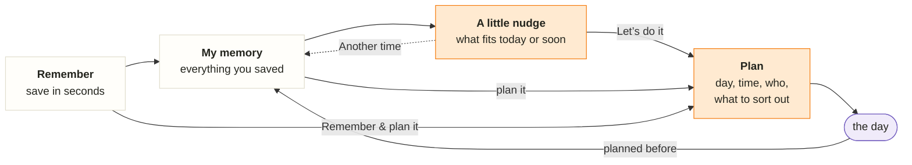
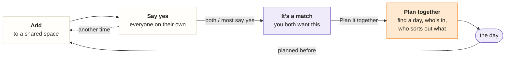

# Roadmap

**Oh, right!** *your little memory*: an external memory for the things you want to experience, on your own and with the people you do things with (your partner, friends, the trip crew), so that when you don’t know what to do, it does. Personal proof of concept; the goal is a phone app.

**Target design:** [oh-app.html](design/oh-app.html), live at https://bazom.github.io/IdeaMemory/design/oh-app.html. Every UI task builds towards it (see [design](design/README.md)).

## What the app is for

1. **Remember for me.** Save something you saw or heard in seconds and stop carrying it in your head.
2. **Help when I don’t know what to do.** Bring back the right saved thing for today or the next few days.
3. **Hold my plans.** Turn a memory into a concrete plan with the details you need on the day.
4. **Do it together.** Share a memory with your partner or a group, see what you all want to do, and plan a date or a trip together. This is one of the app’s biggest features.

## Product principles (owner)

**The core concept is [concept.md](concept.md)**: the memory is the source of truth, and social flows through it (four rules). The principles below follow from it.

Every task is checked against these. 2–5 are from 2026-10-14; 1 was added on 2026-10-15.

1. **Oh, right! is for you and your people (owner, 2026-10-15).** Your memory is always yours; a **space is where you decide together**. A space is *my partner* (a special space: date night, their dates and gifts, your story) or *a group* (up to 8). You suggest ideas from your memory to a space; everyone says “I’d love to” or “Another time”; matches get planned together. Keeping someone else’s idea in your memory is a deliberate tap (2026-10-17). Spaces are visible from the first screen, as tabs. Nothing is ever a hard no: *Another time* always comes back later. No public profiles, no big groups, no in-app chat.
2. **A little nudge recommends from your memory.** It shows things you can do today or very soon as a small deck of cards (swipe right for yes, left for *Another time*), plus one line for the most urgent thing worth knowing (a plan in the next days, or an event that ends or starts soon). The first page stays calm: tabs, headline, the deck and one or two lines; everything else lives in Planned or My memory. Every item says why it is there (owner, 2026-10-17).
3. **My memory is your database of everything you saved.** Plans live in it too; it must work for someone who forgot the details (browse by kind, person, mood, tags; ask in your own words).
4. **Plans come from memories, never from nowhere.** The memory keeps the *why* (note, who told you, link); the plan adds the *how* (day and time, reminder, where, who’s coming, what to sort out, what to bring). One active plan per memory; when its day passes it becomes a “planned before” line on the memory. No done status. In a shared space the plan is shared: everyone answers *I’m in / Maybe / Can’t*, can help find a day and takes on things to sort out.
5. **Saving asks little and infers a lot.** Only the title is required. Every optional detail switches on a feature (kind → icons and browsing, “good for” → suggestions, dates → “coming soon”, who told you → “Lena’s tip”, link → autofill, tags → your own groups). The app fills in what it can and you correct it; missing details are asked for later, at the right moment.

## The main flow

Your guess “create memory → plan memory → …” is close, but the step in between is what makes the app: memories come back to you.



- **Remember:** title, plus optional details or a link that fills them in.
- **My memory:** everything, findable without remembering the words (browse, search, ask).
- **A little nudge:** suggests what fits now; *Another time* puts it aside for a while; *Let’s do it* decides.
- **Plan:** becomes concrete on its own page; shows up in Planned, and in the nudge’s “worth knowing” as the day comes closer.
- **After the day:** back in the memory with a history line; the memory may be suggested again later, planned again, or let go.

Two shortcuts: you can open any memory from My memory and plan it directly, and *Remember & plan it* saves and plans in one go.

**Together** (in a shared space), the same flow with one extra step (suggesting an idea from your memory puts a card into the space): the deck shows what the others suggested; each person says *I’d love to* or *Another time* without seeing the others’ answers first; when you both (or most of a group) say yes, it’s a **match**, and *Plan it together* turns it into a shared plan.



## Done

- **Accounts:** sign up and sign in with a username and password; each account sees only its own data.
- **Manual memories (backend and a first UI):** save with just a title (description, category, tags, notes, location, exact original text), browse newest first, filter by category, open, edit, delete.
- **Design:** the clickable target design ([oh-app.html](design/oh-app.html)), including couples and groups.

## Where we are (2026-10-15)

- **Built:** accounts and manual memories (backend and a first Flutter UI, still the old look).
- **Designed:** the complete target, including couples and groups ([oh-app.html](design/oh-app.html)); this roadmap and the [decisions](decisions.md) match it.
- **Next:** 010 (the oh! look in the real app), then 011–013. Start a task by asking for it in chat; security-relevant tasks need the owner’s explicit OK first.
- **Decision point:** after 018 and a test with 3–4 couples (see the [vision](vision.md) for the four numbers).

## Plan

Phases in order. Each task is small enough to try on the same day; the order inside a phase can change. Tasks use the short format at the end.

### Phase 1: the oh! app with today’s data (no AI)

### 010 — The oh! look
Goal: the real app looks and reads like the design.
Done when:
- theme (colors light and dark, Nunito, shapes, companion) and the three-tab shell (A little nudge, Planned, My memory) with the header and “Remember this”
- sign-in, Remember and the memory note page use the oh! layout and voice
- existing features keep working

Not now: new data, suggestions, plans.
Security-relevant: no.

### 011 — Richer memories
Goal: save the details that power the other pages.
Done when:
- a memory can carry kind (the design’s list, including gift ideas), “good for” (date night, with friends, a quiet evening, on my own), conditions (booking, weather, weekend, cost), who told you, **for whom and which occasion** (private; the occasion is also saved as a date), your tags, a link and event dates (from, until)
- Remember asks for them as optional one-tap chips; only the title is required
- My memory is calm: one search box (title, note, people, place, link title, tags), **one row of categories**, a compact one-line list; *Ask your memory* is offered only when the search finds nothing; rarely used details sit behind *More details* when saving
- memories stay owned by one person (as today); 015 adds spaces that show cards of suggested memories, so nothing has to move

Not now: link fetching, AI, sharing.
Security-relevant: yes (schema change) → review before merge.

### 012 — A little nudge (rules)
Goal: the first page brings back the right memory for today or the next days.
Done when:
- *Oh, right!* lines above the deck (at most two): an occasion with a saved gift idea in the next 3 weeks, your own event ending or starting soon
- a deck of every memory that fits (doable soon, not planned, no own dates, no multi-day trips, no gifts), ordered by context (weather, how long it has waited), each card saying why; drag right for *Let’s do it*, left for *Another time*, with the same two buttons under the card
- *Another time* hides a memory for a few days (stored, so it holds across devices)
- one line for the most urgent thing (a plan in the next 3 days, else an event ending or starting within a week); a “Not this? Browse your memory” link

Not now: AI ranking.
Security-relevant: no.

### 013 — Plans
Goal: turn a memory into a concrete plan.
Done when:
- *Let’s do it* picks a day (tonight, tomorrow, this weekend, pick a day) and opens the plan page: time, reminder choice, where (open in maps), who’s coming, checklist, what to bring, the memory’s note
- the Planned tab: next up, this week, later, worth planning
- a passed plan becomes a “planned before” line on its memory; one active plan per memory; *Remember & plan it*

Not now: push notifications (reminders show in the app until 014), sharing (015–017).
Security-relevant: yes (new table with ownership) → review before merge.

### Phase 2: together

Sharing needs everyone on their own phone, so it starts with hosting. Regular things (a weekly drink, date night) come last, once matches and plans work.

### 014 — On our phones
Goal: open the app on any phone over HTTPS, install it to the home screen, get reminders.
Done when:
- hosting approved and running, data private, home-screen install works
- plan reminders arrive as notifications
- account recovery decided and in place before anyone else signs up

Needs owner approval first: hosting, region, cost, recovery method.
Security-relevant: yes → review before merge.

### 015 — Spaces and suggestions
Goal: decide things together with your partner or a group, while your memory stays yours.
Done when:
- start a space as *my partner* or *a group* (up to 8; a best friend is a group of two) and invite with a link; the invited person signs up or signs in and joins; leave a space; the owner can remove someone or turn the link off
- space tabs under the header (Just me, each space, + New); Remember is the round + in the header
- *Suggest to…* (when saving, or on a memory’s page) puts a card of your memory into one or more spaces; you can stop suggesting it; deleting the memory removes its cards
- a new space works fully from the start: a partner space shows the date-night offer and *For Sam* with *Add a date*; a group can *Set up a weekly thing* (what, day, time, where, on from how many)
- **one deck per space**: new ideas to answer and things you all want (*Let’s do it* opens a calendar to pick the day, months ahead too, a range for trips; it marks date night ♥ and event days 🎟 but never picks for you), the next plan as a slim line above, *You suggested* below; the partner space shows special days as emojis (🎂, 💍), 🎁 *For Lena* and ❤️ *Our story* as a pop-up
- each group has one list, **Ready to plan** (plans to join, then matches nobody planned yet), and a partner space has *You both want*; new ideas are answered only in the deck, and your own suggestions show in *You suggested* on the space page; cards show who suggested it and why, plus up to four facts (when, where, cost, booking, people); My memory never shows space contents
- *Keep in my memory* on someone else’s card copies it into your memory as their idea; saying yes alone does not
- after signup: “Who do you do things with?” (my partner, a group, just me for now); in *Just me*, the invite card once there are “date night” or “with friends” memories
- the database shows a card only to members of that space, and never your other memories (tested with a non-member)

Not now: votes, shared plans, news dots.
Security-relevant: yes (membership-based access) → review before merge.

### 016 — Say yes together
Goal: find out what you all want to do, without “I don’t know, what do you want?”.
Done when:
- in a shared space the deck holds the cards you haven’t answered (*Lena’s idea*, and events with *don’t miss it*); *I’d love to* (right) / *Another time* (left); others’ answers stay hidden until you answer
- *Another time* is never a hard no: it comes back after a few weeks, or sooner, warmly (“Back again: Lena still loves this”); after the third time only you are asked “Keep for someday, or hide it for me?”, and hiding can be undone
- a match (both of you; in a group, enough people for the idea: 2, unless the suggester set *at least N people*; most ideas say *whoever comes*) opens “It’s a match!”; for partners, matches go into **You both want** (the partner’s *Ready to plan*; no separate jar); for groups, matches are *Ready to plan*, sorted by how many are in, each saying who (“Max, Jonas, Aylin are in · needs 4”)
- news counts on the space tabs (“Lena added 2 things”), cleared when you open the space

Not now: notifications for news (later, with 014’s notifications).
Security-relevant: yes (shared rows) → review before merge.

### 017 — Plan together
Goal: plan a date or a trip together.
Done when:
- anyone who wants an idea can start its plan (*Start the plan*); there is one plan per idea, so once it exists the others see *Mira started a plan* and *Join the plan*, and everyone who joined can edit it; for date night, whoever picks plans it; a plan in a shared space is shared: in a group everyone answers *I’m in / Maybe / Can’t*; for a couple the page is lighter (the partner’s “Works for me”, no who’s-in list)
- ideas marked *needs booking* get the to-do “Book it” when planned
- *Let everyone pick*: three suggested days, everyone taps what works, someone picks the best one
- things to sort out can be given to a person; short notes on the plan (no chat; a button opens your own group chat); trips have a day-by-day list
- an invite link for people without the app: a plan card with *I’m in / Maybe / Can’t*, no account needed, can be turned off

Not now: costs per person, in-app chat.
Security-relevant: yes (shared plans, public link) → review before merge.

### 018 — Every week, and the partner space
Goal: regular things organise themselves, and the partner space feels special, without pressure.
Done when:
- a group can set a **fixed weekly activity** (“Drinks at Bar Zentral, every Friday 20:00, on from 3 people”); on its day the app asks everyone (“… tonight. In?”), answering is optional and only the *in*s count, and at a set time it says “It’s on!” or “Skipped this week”; that day the space’s page *is* this card (*I’m in* / *Not tonight*, *Ask in WhatsApp*, a streak), with a link to the other ideas
- a partner space is **offered** a date night once (never required), on **a fixed day** (every Tuesday) or **flexible** (once a week or every two weeks; one nudge at the start, and whoever draws picks the day); with it on, the date night card shows the next date night with **Pick one** (from *You both want*) and **Surprise me** (a random one, *Another one* as often as you like, *Not now* stops), which plan it for that day, and couples can **take turns** (one plans, the other only sees the time); at most one gentle reminder, and if nothing is planned, nothing happens
- the partner space also has **For Lena** (private: occasions like her birthday and your anniversary, gift ideas, things she mentioned; back before the day) and **Our story** (what you did together; “one year ago today…”)
- Planned lists the regular things under *Every week*

Not in the MVP: open slots (a group’s regular afternoon to fill with *Pick together*).

Needs: notifications from 014.
Not now: rotating hosts, costs, chat.
Security-relevant: yes (scheduled notifications, shared rows) → review before merge.

### Phase 3: less typing, better finding (first AI)

### 019 — Save from a link
Goal: paste a link and most fields fill themselves.
Done when:
- the server fetches the page safely (no local or private addresses, size and time limits) and reads title, site, description, image and, where the page states them, event dates
- kind is suggested from the site type (maps → place, film sites → film, ticket sites → event); you confirm
- if fetching fails you still save by hand; the original link is kept

Not now: AI, screenshots.
Security-relevant: yes (fetching untrusted URLs) → review before merge.

### 020 — “Fill it in for me” (AI step 1)
Goal: AI suggests kind, “good for”, tags and dates from the link text and your note.
Done when:
- suggestions appear as pre-selected chips with “Filled in from the link. Check it?”; nothing is saved without your Save
- only that one memory’s text is sent; it works without AI (feature off or provider down)

Needs owner approval first: provider and model, what is sent, monthly budget.
Security-relevant: yes → review before merge.

### 021 — Ask your memory (AI step 2)
Goal: find something when you don’t remember the words (“that restaurant Lena mentioned”).
Done when:
- a question returns up to three memories from the current space with a short answer in oh!’s voice; it never mentions anything that isn’t saved there
- retrieval runs only over rows you can see (database search first, embeddings if needed); the answer cites the memories it used

Needs owner approval first (as 020).
Security-relevant: yes → review before merge.

### Phase 4: more ways in

### 022 — Save from a screenshot
Goal: keep a screenshot as the memory’s source and let AI read it.
Done when: private image storage that follows the memory’s space, the image shows on the memory, deleting the memory deletes the image, AI suggests fields from it (as 020).
Security-relevant: yes (private file storage) → review before merge.

### 023 — Smarter nudge (optional AI step 3)
Goal: better order and wording of suggestions once there is real usage (what you planned, what you skipped, what matched).
Done when: a measurable improvement over the rules from 012 on your own data; the rules remain the fallback.

### Later, only if needed
- **Costs per person** on a trip plan.
- **Save from the phone’s share sheet** (needs an installed app).
- **In-app chat:** not planned; only if testers ask for it after 018. Group conversation stays in WhatsApp or Signal (the plan has short notes and a link to the group chat).

## When AI comes in, and why

- **Not before phase 3.** The app must be useful without AI: rules can pick suggestions because you gave the details when saving. Without good data AI has nothing to work with, and every call costs money and privacy.
- **First where it removes typing (020).** Saving has to be fast or nobody saves; AI turns a pasted link or a rough note into filled-in chips. One short call per save, you confirm, nothing else is sent.
- **Second where words fail (021).** Search needs you to remember the words; asking in your own words fixes that. It only works over your own memories and must cite them, never invent.
- **Suggestions stay rule-based at first (012).** Rules are explainable (“ends in 3 days”, “on your mind for 7 weeks”) and free. AI can improve the order and wording later (023) once there is usage to learn from.
- **Why together comes before AI:** sharing is the reason people bring others in and the clearest reason to pay; AI only makes saving and finding easier. Rules still pick suggestions in shared spaces; matches come from people, not from a model.
- **Rules for every AI feature:** owner approves provider, model and budget first; calls run on the server, never in the app; only the minimum text is sent, nothing about the account or the other members; no content in logs; the app keeps working when AI is off or down.

## Task format

```text
## NNN — <what I can do afterwards>
Goal: one sentence.
Done when:
- 2–4 things I can check myself
Not now: what is deliberately left out
Security-relevant: yes/no (yes → review before merge)
```

Implementation: simplest design that meets “Done when”, about 3–5 tests (main path, one failure, ownership for a new table or route), `make check`, and a few lines on how to try it. The UI follows the [target design](design/oh-app.html); deviations need the owner’s OK.
