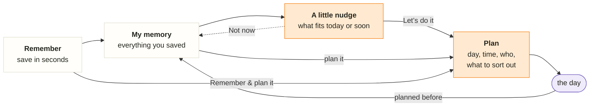

# Roadmap

**oh! your little memory**: a private external memory for the things you want to experience, so that when you don’t know what to do, it does. Personal proof of concept; the goal is a phone app.

**Target design:** [oh-app.html](design/oh-app.html), live at https://bazom.github.io/IdeaMemory/design/oh-app.html. Every UI task builds towards it (see [design](design/README.md)).

## What the app is for

1. **Remember for me.** Save something you saw or heard in seconds and stop carrying it in your head.
2. **Help when I don’t know what to do.** Bring back the right saved thing for today or the next few days.
3. **Hold my plans.** Turn a memory into a concrete plan with the details you need on the day.

## Product principles (owner, 2026-10-14)

Every task is checked against these.

1. **A little nudge recommends from your memory.** It shows things you can do today or very soon: one main suggestion (a swipeable loop of everything that fits), and at most three things worth knowing (plans in the next days, events that end or start soon). Every item says why it is there.
2. **My memory is your database of everything you saved.** Plans live in it too; it must work for someone who forgot the details (browse by kind, person, mood, tags; ask in your own words).
3. **Plans come from memories, never from nowhere.** The memory keeps the *why* (note, who told you, link); the plan adds the *how* (day and time, reminder, where, who’s coming, what to sort out, what to bring). One active plan per memory; when its day passes it becomes a “planned before” line on the memory. No done status.
4. **Saving asks little and infers a lot.** Only the title is required. Every optional detail switches on a feature (kind → icons and browsing, “good for” → suggestions, dates → “coming soon”, who told you → “Lena’s tip”, link → autofill, tags → your own groups). The app fills in what it can and you correct it; missing details are asked for later, at the right moment.

## The main flow

Your guess “create memory → plan memory → …” is close, but the step in between is what makes the app: memories come back to you.



- **Remember:** title, plus optional details or a link that fills them in.
- **My memory:** everything, findable without remembering the words (browse, search, ask).
- **A little nudge:** suggests what fits now; *Not now* puts it aside for a while; *Let’s do it* decides.
- **Plan:** becomes concrete on its own page; shows up in Planned, and in the nudge’s “worth knowing” as the day comes closer.
- **After the day:** back in the memory with a history line; the memory may be suggested again later, planned again, or let go.

Two shortcuts: you can open any memory from My memory and plan it directly, and *Remember & plan it* saves and plans in one go.

## Done

- **Accounts:** sign up and sign in with a username and password; each account sees only its own data.
- **Manual memories (backend and a first UI):** save with just a title (description, category, tags, notes, location, exact original text), browse newest first, filter by category, open, edit, delete.
- **Design:** the clickable target design ([oh-app.html](design/oh-app.html)).

## Plan

Phases in order. Each task is small enough to try on the same day; the order inside a phase can change. Tasks use the short format at the end.

### Phase 1: the oh! app with today’s data (no AI)

### 010 — The oh! look
Goal: the real app looks and reads like the design.
Done when:
- theme (colors light and dark, Nunito, shapes, companion) and the three-tab shell (A little nudge, Planned, My memory) with the header and “Remember this”
- sign-in, Remember and the memory note page use the oh! layout and voice
- existing features keep working

Not now: new data, suggestions, plans.
Security-relevant: no.

### 011 — Richer memories
Goal: save the details that power the other pages.
Done when:
- a memory can carry kind (the design’s list), “good for” moods, who told you, your tags, a link and event dates (from, until)
- Remember asks for them as optional one-tap chips; only the title is required
- My memory: search covers title, note, person, place, link title and tags; browse rows by kind, person, mood and tag; shelves New, Still on your mind, Long forgotten

Not now: link fetching, AI.
Security-relevant: yes (schema change) → review before merge.

### 012 — A little nudge (rules)
Goal: the first page brings back the right memory for today or the next days.
Done when:
- a swipeable loop of every memory that fits (doable soon, not planned, no own dates, no multi-day trips), longest-waiting first, each with why
- *Not now* hides a memory for a few days (stored, so it holds across devices)
- “Worth knowing”: at most three items (plans in the next 3 days, events ending or starting soon); mood links into My memory

Not now: AI ranking.
Security-relevant: no.

### 013 — Plans
Goal: turn a memory into a concrete plan.
Done when:
- *Let’s do it* picks a day (tonight, tomorrow, this weekend, pick a day) and opens the plan page: time, reminder choice, where (open in maps), who’s coming, checklist, what to bring, the memory’s note
- the Planned tab: next up, this week, later, worth planning
- a passed plan becomes a “planned before” line on its memory; one active plan per memory; *Remember & plan it*

Not now: push notifications (reminders show in the app until 019), sharing.
Security-relevant: yes (new table with ownership) → review before merge.

### Phase 2: less typing, better finding (first AI)

### 014 — Save from a link
Goal: paste a link and most fields fill themselves.
Done when:
- the server fetches the page safely (no local or private addresses, size and time limits) and reads title, site, description, image and, where the page states them, event dates
- kind is suggested from the site type (maps → place, film sites → film, ticket sites → event); you confirm
- if fetching fails you still save by hand; the original link is kept

Not now: AI, screenshots.
Security-relevant: yes (fetching untrusted URLs) → review before merge.

### 015 — “Fill it in for me” (AI step 1)
Goal: AI suggests kind, “good for”, tags and dates from the link text and your note.
Done when:
- suggestions appear as pre-selected chips with “oh! filled this in, check it?”; nothing is saved without your Save
- only that one memory’s text is sent; it works without AI (feature off or provider down)

Needs owner approval first: provider and model, what is sent, monthly budget.
Security-relevant: yes → review before merge.

### 016 — Ask your memory (AI step 2)
Goal: find something when you don’t remember the words (“that restaurant Lena mentioned”).
Done when:
- a question returns up to three of *your* memories with a short answer in oh!’s voice; it never mentions anything you didn’t save
- retrieval runs over your own rows only (database search first, embeddings if needed); the answer cites the memories it used

Needs owner approval first (as 015).
Security-relevant: yes → review before merge.

### Phase 3: more ways in, then out into the world

### 017 — Save from a screenshot
Goal: keep a screenshot as the memory’s source and let AI read it.
Done when: private image storage, the image shows on the memory, deleting the memory deletes the image, AI suggests fields from it (as 015).
Security-relevant: yes (private file storage) → review before merge.

### 018 — Smarter nudge (optional AI step 3)
Goal: better order and wording of suggestions once there is real usage (what you planned, what you skipped).
Done when: a measurable improvement over the rules from 012 on your own data; the rules remain the fallback.

### 019 — On my phone
Goal: open the app on the phone over HTTPS, install it to the home screen, get reminders.
Done when: hosting approved and running, data private, home-screen install works, plan reminders arrive as notifications; account recovery decided before inviting anyone.
Needs owner approval first: hosting, region, cost.
Security-relevant: yes → review before merge.

### Later, only if needed
- **Share a plan:** an invite link anyone can open, with “I’m in / Maybe”; answers show under who’s coming. Group chat stays in WhatsApp or Signal (link to it).
- **Shared plans and chat** with other accounts: a different product; only if the invite link is not enough.

## When AI comes in, and why

- **Not before phase 2.** The app must be useful without AI: rules can pick suggestions because you gave the details when saving. Without good data AI has nothing to work with, and every call costs money and privacy.
- **First where it removes typing (015).** Saving has to be fast or nobody saves; AI turns a pasted link or a rough note into filled-in chips. One short call per save, you confirm, nothing else is sent.
- **Second where words fail (016).** Search needs you to remember the words; asking in your own words fixes that. It only works over your own memories and must cite them, never invent.
- **Suggestions stay rule-based at first (012).** Rules are explainable (“ends in 3 days”, “on your mind for 7 weeks”) and free. AI can improve the order and wording later (018) once there is usage to learn from.
- **Rules for every AI feature:** owner approves provider, model and budget first; calls run on the server, never in the app; only the minimum text is sent, nothing about the account; no content in logs; the app keeps working when AI is off or down.

## Task format

```text
## NNN — <what I can do afterwards>
Goal: one sentence.
Done when:
- 2–4 things I can check myself
Not now: what is deliberately left out
Security-relevant: yes/no (yes → review before merge)
```

Implementation: simplest design that meets “Done when”, about 3–5 tests (main path, one failure, ownership for a new table or route), `make check`, and a few lines on how to try it. The UI follows the [target design](design/oh-app.html); deviations need the owner’s OK.
