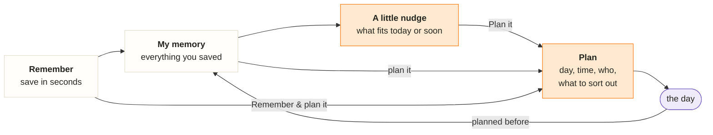
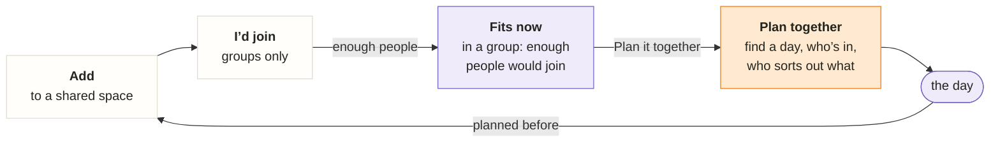

# Roadmap

**Oh, right!** *your little memory*: an external memory for the things you want to experience, on your own and with the people you do things with (your partner, friends, the trip crew), so that when you don’t know what to do, it does. Personal proof of concept; the goal is a phone app.

**Target design:** [oh-app.html](design/oh-app.html), live at https://bazom.github.io/IdeaMemory/design/oh-app.html: the complete future app. We build it in **milestones** (below) made of small **[slices](slices/README.md)**, each with its own design board, written one or two ahead.

## What the app is for

1. **Remember for me.** Save something you saw or heard in seconds and stop carrying it in your head.
2. **Help when I don’t know what to do.** Bring back the right saved thing for today or the next few days.
3. **Hold my plans.** Turn a memory into a concrete plan with the details you need on the day.
4. **Do it together.** Share a memory with your partner or a group, see what you all want to do, and plan a date or a trip together. This is one of the app’s biggest features.

## Product principles (owner)

**The core concept is [concept.md](concept.md)**: the memory is the source of truth, and social flows through it (four rules). The principles below follow from it.

Every task is checked against these. 2–5 are from 2026-10-14; 1 was added on 2026-10-15.

1. **Oh, right! is for you and your people (owner, 2026-10-15).** Your memory is always yours; a **space is where you decide together**. A space is *my partner* (date night, their special days and gifts) or *a group* (up to 8). An idea is just for you or for one or more spaces; a space shows everyone’s ideas, what fits now first, and anyone can plan one. Partners don’t vote; in a group you tap *I’d join*, and there is no “no” anywhere (2026-10-18). People still talk to each other; the app remembers and plans. Keeping someone else’s idea in your memory is a deliberate tap. Spaces are tabs on the first screen. No public profiles, no big groups, no in-app chat.
2. **A little nudge recommends from your memory.** It shows *today’s pick* (the best fit as a card, *Another* shows the next) and the rest that fits now, with the season as the reason (“🌧️ Rainy October · 8 things fit”); the rest waits under *Later*. Above it at most two *Oh, right!* lines. The first page stays calm: tabs, headline, the pick, a short list; everything else lives in Planned or My memory. Every item says why it is there (owner, 2026-10-17).
3. **My memory is your database of everything you saved.** Plans live in it too; it must work for someone who forgot the details (browse by kind, person, mood, tags; ask in your own words).
4. **Plans come from memories, never from nowhere.** The memory keeps the *why* (note, who told you, link); the plan adds the *how* (day and time, reminder, where, who’s coming, what to sort out, what to bring). One active plan per memory; when its day passes it becomes a “planned before” line on the memory. No done status. In a shared space the plan is shared: everyone answers *I’m in / Maybe / Can’t*, can help find a day and takes on things to sort out.
5. **Saving asks little and infers a lot.** Only the title is required. Every optional detail switches on a feature (kind → icons and browsing, who it’s for → which spaces, when it’s good (warm days, cold days, weekends) → what fits now, dates → “coming soon”, who told you → “Lena’s tip”, link → autofill, tags → your own groups). The app fills in what it can and you correct it; missing details are asked for later, at the right moment.

## The main flow

Your guess “create memory → plan memory → …” is close, but the step in between is what makes the app: memories come back to you.

- **Remember:** title, plus optional details or a link that fills them in.
- **My memory:** everything, findable without remembering the words (browse, search, ask).
- **A little nudge:** today’s pick and what else fits now (season, weekend, event dates); the rest waits under *Later*; *Plan it* decides.
- **Plan:** becomes concrete on its own page; shows up in Planned, and in the nudge’s “worth knowing” as the day comes closer.
- **After the day:** back in the memory with a history line; the memory may be suggested again later, planned again, or let go.

Two shortcuts: you can open any memory from My memory and plan it directly, and *Remember & plan it* saves and plans in one go.

**Together** (in a shared space), the same flow: an idea you save for a space shows up there for everyone; anyone plans it and the others join. In a group, people tap *I’d join* first, and the idea fits once enough people would join.

## Done

- **Accounts:** sign up and sign in with a username and password; each account sees only its own data.
- **Manual memories (backend and a first UI):** save with just a title (description, category, tags, notes, location, exact original text), browse newest first, filter by category, open, edit, delete.
- **Design:** the clickable target design ([oh-app.html](design/oh-app.html)), earlier versions in [explorations](design/explorations/README.md); capture research in [research](research/capture-from-social-media.md).

## Where we are (2026-10-18)

- **Built:** accounts and manual memories (the old look).
- **Next:** slice [1.1](slices/1.1-memory-model-and-look.md), then [1.2](slices/1.2-save-and-manage.md). Start a slice by asking for it in chat; security-relevant slices need the owner’s explicit OK first.
- **Order (owner, 2026-10-18):** *Just me* first and complete (capture → plan → suggest), spaces after.

## Milestones

| Milestone | What you get | Exit test |
| --- | --- | --- |
| **M1 Just me v1** | save anything with almost no effort, find it, plan it, get suggestions | you use it daily for two weeks and save without thinking |
| **M2 Native app** | share extension on iPhone and Android, reading screenshots on the phone | saving from Instagram takes 3 taps or fewer on both phones |
| **M3 Spaces** | partner and group spaces, plans together, weekly things | 3–4 couples test it (the four numbers in the [vision](vision.md)) |
| **M4 Smarter** | ask your memory, better suggestions | measurably better than the rules on your own data |

After each milestone: a short review, then the concept, the target design and this roadmap are updated, and the next milestone is sliced.

## M1 — Just me v1

Slices in order; only the next one or two are written out (see [slices](slices/README.md)). Hosting comes early because sharing from a phone needs a server the phone can reach.

| # | Slice | You can… | Status |
| --- | --- | --- | --- |
| 1.1 | [Memory model and the oh! look](slices/1.1-memory-model-and-look.md) | see your memories in the new design: search, kinds, who it’s for | draft |
| 1.2 | [Save and manage](slices/1.2-save-and-manage.md) | save by typing with who / kind / when it’s good; edit, let go | draft |
| 1.3 | On your phone | use it from your phone over HTTPS, install it; account recovery decided | later |
| 1.4 | Paste a link | TikTok, YouTube, Maps and websites fill themselves in (official previews only) | later |
| 1.5 | Share into the app | Android share target, iOS Shortcut, “What was it?” at share time; saved instantly | later |
| 1.6 | Screenshots and *Needs a look* | share a screenshot, AI reads it, you confirm with one tap | later |
| 1.7 | Plan it | the calendar, the plan page, the Planned tab | later |
| 1.8 | Suggest | today’s pick, Fits now / Later, *Oh, right!* moments | later |
| 1.9 | Dates and gifts | birthdays and anniversaries, gift ideas back in time | later |

Rules that hold for every slice: no scraping (only official previews, the user’s own words and screenshots, see [research](research/capture-from-social-media.md)); saving never waits and never fails (understanding happens afterwards); AI only with an approved provider, model and budget.

## M2 — Native app (sketch)

A Flutter iOS and Android build of the same app with a share extension (instant save, “What was it?”), screenshots straight from the preview, on-phone text reading, real notifications. Needs: Apple Developer Program ($99/yr, owner approval), Play Console ($25) or sideloading.

## M3 — Spaces (sketch)

From the [concept](concept.md): partner and group spaces with invite links (up to 8); “who it’s for” names become spaces (“6 ideas with Lena: add them to You & Lena?”); one page per space (today’s pick, Fits now, Who’d join? in groups, Later); plans together (who’s in, things to sort out, notes, a guest link); weekly things (date night, drinks on Fridays). Security: a space sees only the memories added to it (row-level security on membership).

## M4 — Smarter (sketch)

Ask your memory in your own words (only over your own memories, citing them); better order and wording of suggestions from real usage; bulk import of your own Instagram/TikTok saved-posts export.

## Later, only if needed

- Costs per person on a trip plan.
- In-app chat: not planned; conversation stays in WhatsApp or Signal.
- Telegram or WhatsApp bot as a share target.

## When AI comes in, and why

- **Only where it removes effort when saving (M1, 1.6).** Instagram gives us nothing but a link, so a screenshot read by AI, or a few words from you, is how a saved post becomes a memory. One small call per save, you confirm, nothing is saved without you.
- **Suggestions stay rule-based (1.8).** Rules are explainable (“ends in 3 days”, “cold days: now’s the time”) and free. AI can improve order and wording later (M4) once there is usage to learn from.
- **Asking your memory comes in M4**, over your own memories only, citing them, never inventing.
- **Rules for every AI feature:** owner approves provider, model and budget first; calls run on the server, never in the app; only the minimum is sent, nothing about the account; no content in logs; the app keeps working when AI is off or down.

## Slice format

See [slices](slices/README.md): one file per slice (goal, towards, design board, data, API and app, security, done when, not now, open questions, parked). Implementation: simplest design that meets “Done when”, about 3–5 tests (main path, one failure, ownership for a new table or route), `make check`, and a few lines on how to try it. The UI follows the slice’s design board; deviations need the owner’s OK.
